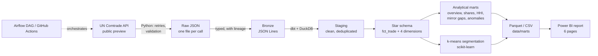
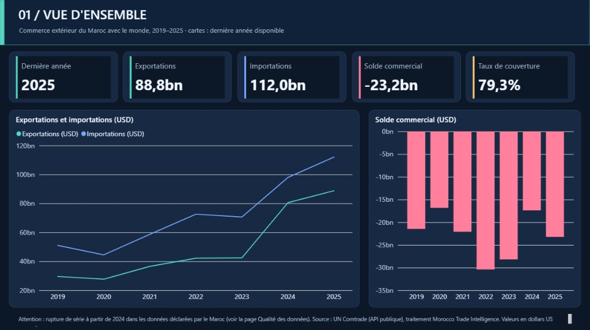
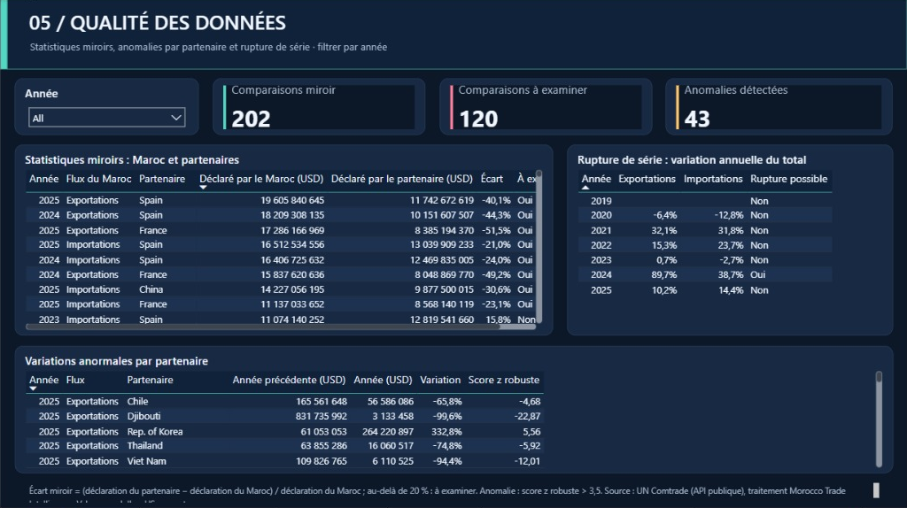

# Morocco Trade Intelligence

Automated data pipeline, analytical warehouse and Power BI report on Morocco's foreign trade, built from public **UN Comtrade** data.

**Status: v1.0.** Extraction, quality controls, dbt star schema, analytical marts, anomaly detection, partner segmentation, Airflow orchestration and a six-page Power BI report.

## Business questions

- How do Morocco's exports, imports and trade balance evolve?
- Which partner countries and HS chapters weigh the most?
- How concentrated is Morocco's trade on a few partners, overall and for automotive products (cars, vehicle parts, wiring)?
- Do partners' declarations match Morocco's? Large mirror gaps point to data-quality or classification issues worth reviewing.
- Which partner flows change abnormally, and which groups of partners behave alike?

## Architecture



| Layer | Content |
|---|---|
| Extraction (`src/mti/extract.py`) | 70 API calls for 2019–2025, each kept under the 500-row limit of the public endpoint. A run is all-or-nothing: the previous snapshot is replaced only if every call succeeded. |
| Bronze (`src/mti/bronze.py`) | Fixed schema, explicit types, lineage columns (`_dataset`, `_request_id`, `_fetched_at`, `_source_file`). |
| Staging (`dbt/models/staging`) | Renaming, casting, deduplication on the business key. |
| Star schema (`dbt/models/marts/core`) | `fct_trade` (reporter × partner × flow × year × product) with `dim_country`, `dim_product`, `dim_flow`, `dim_year`. |
| Analytics (`dbt/models/marts/analytics`) | Trade overview, partner shares, HS chapter structure, partner concentration (HHI), mirror gaps, flow anomalies. |
| Segmentation (`src/mti/segmentation.py`) | k-means on four partner features, k chosen by silhouette score. |
| Orchestration (`airflow/`, `.github/workflows/`) | Airflow DAG with one task per step; monthly refresh on GitHub Actions. |
| Report (`powerbi/`) | Power BI project (TMDL semantic model + PBIR report) reading `data/marts` from GitHub. |

## Data quality

- **Extraction checks:** HTTP status, response shape, API error message, unexpected reporter or year, and truncation (a call returning 500 rows fails instead of silently losing data).
- **dbt data tests (45+):** uniqueness and non-null keys, accepted values, referential integrity between the fact table and every dimension, no negative values, HHI within bounds, no conflicting duplicates in the source.
- **Reconciliation:** the sum of HS chapters is compared with the reported total; gaps above 1 % raise a warning.
- **Series-break check:** a yearly change above 50 % in Morocco's total exports or imports raises a warning.
- **Pipeline report:** every refresh writes [`data/pipeline_report.json`](data/pipeline_report.json) with record counts per dataset, empty calls, dbt test results and the segmentation summary.

## Data-quality finding: a possible break in Morocco's series from 2024

The first run on real data (November 2026) showed that Morocco's totals reported in UN Comtrade jump in 2024:

| Year | Exports (USD bn) | Imports (USD bn) |
|---|---:|---:|
| 2023 | 42.5 | 70.6 |
| 2024 | 80.6 | 98.0 |
| 2025 | 88.8 | 112.0 |

- The API itself returns these values, as a single total row: the jump is not created by the pipeline.
- Morocco's national statistics (Office des Changes) report 2024 exports of 456.3 bn MAD and imports of 761.3 bn MAD, roughly 46 and 76 bn USD at about 10 MAD per USD.
- The mirror statistics point the same way: the share of partners flagged for review rises from about half in 2019–2023 to 25 of 28 comparisons in 2024.

**What remains to be checked:** the gap may come from a change in coverage (for example free zones or goods for processing), in valuation or in compilation method; the pipeline does not decide which. Unit and scope were checked as far as public sources allow: both figures are annual merchandise exports.

**Consequence:** values reported by Morocco for 2024 and 2025 should not be compared with earlier years without caution. The pipeline keeps the source values unchanged, flags the break (`possible_series_break` in `mart_trade_overview`, plus a dbt warning) and leaves the interpretation to the analyst. Partner shares within a given year remain usable, and the segmentation uses 2019–2023 only.

## Advanced analytics

- **Flow anomalies (`mart_flow_anomalies`):** each partner's year-on-year change (log scale) is compared with the changes of all partners in the same year and flow, using a robust z-score (median and median absolute deviation). Partners worth at least 50 million USD the previous year are scored; |z| > 3.5 is flagged. Because the reference is the same year's median, a shift that moves every partner at once, like the 2024 break, is not flagged by itself.
- **Partner segmentation (`mart_partner_segments`, `mart_segment_profiles`):** k-means on four standardised features (size of the relationship, export share, annual growth, automotive share of exports) for partners above 100 million USD of average trade, 2019–2023. k is chosen between 3 and 6 by silhouette score, and each segment gets a readable label from its median profile.

## Run it

GitHub Actions does everything:

- **CI** (every push): unit tests, then the full pipeline and all dbt tests on synthetic API answers, without network.
- **Airflow** (when the pipeline changes): builds the Airflow image and runs the whole DAG once on synthetic data.
- **Refresh data** (monthly, or manually from the Actions tab): real UN Comtrade data, dbt build, segmentation, export to [`data/marts`](data/marts), commit of the results.

Locally (Python 3.10+):

```bash
python -m venv .venv
source .venv/bin/activate          # Windows: .venv\Scripts\activate
pip install -r requirements.txt
pytest -q
python run_pipeline.py --offline   # synthetic data, no network
python run_pipeline.py             # real UN Comtrade data, 2019-2025
```

With Airflow (Docker Desktop):

```bash
docker compose up --build          # then open http://localhost:8080, user: admin
docker compose exec airflow cat /opt/airflow/standalone_admin_password.txt
```

The DAG `morocco_trade_intelligence` has one task per step: `extract → bronze → dbt → segment → export → report`. Only the extraction is retried, since it is the only step that depends on an external service.

## Power BI report

Six pages: overview, partners, products, automotive and concentration, data quality, segmentation.





- **Quick look:** [`powerbi/MoroccoTradeIntelligence.pbix`](powerbi/MoroccoTradeIntelligence.pbix), a snapshot saved in November 2026.
- **Latest data:** open [`powerbi/MoroccoTradeIntelligence.pbip`](powerbi) with Power BI Desktop and refresh; the report loads the current tables from this repository.
- All pages and instructions: [`powerbi/README.md`](powerbi/README.md).

## Data notes and limits

- Source: [UN Comtrade](https://comtradeplus.un.org/) public preview API, annual data, HS classification, values in current US dollars. The parameters mirror the official [comtradeapicall](https://github.com/uncomtrade/comtradeapicall) package.
- Exports are usually valued FOB and imports CIF, so mirror gaps of a few percent are expected.
- The automotive focus uses three HS headings (8703, 8708, 8544); it is an indicator, not a full definition of the automotive sector.
- Anomalies and segments describe statistical patterns; they are starting points for analysis, not conclusions.
- The synthetic API answers in `src/mti/fake_api.py` exist only for tests and `--offline` runs; they are never exported as results.

## Roadmap

- [x] v0.1 — extraction, quality checks, star schema, analytical marts, CI
- [x] v0.2 — Airflow orchestration in Docker (layout inspired by [portable-data-stack-airflow](https://github.com/cnstlungu/portable-data-stack-airflow), MIT)
- [x] v0.3 — Power BI report on the exported tables
- [x] v0.4 — anomaly detection on partner flows and partner segmentation
- [ ] Next — load the warehouse into PostgreSQL as an alternative target; monthly data

## Documentation

- [Guide de compréhension (français)](docs/GUIDE_FR.md) — every step explained, indicators, limits and likely interview questions.
- [Rapport Power BI (français)](powerbi/README.md) — opening, refreshing and exporting the report.

## License

MIT — see [LICENSE](LICENSE).
