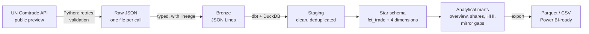

# Morocco Trade Intelligence

Automated data pipeline and analytical warehouse on Morocco's foreign trade, built from public **UN Comtrade** data.

**Status: v0.1 — work in progress.** Data collection, quality controls, the star schema and the analytical tables are in place. Airflow orchestration and a Power BI report are the next steps (see [Roadmap](#roadmap)).

## Business questions

- How do Morocco's exports, imports and trade balance evolve?
- Which partner countries and HS chapters weigh the most?
- How concentrated is Morocco's trade on a few partners, overall and for automotive products (cars, vehicle parts, wiring)?
- Do partners' declarations match Morocco's? Large mirror gaps point to data-quality or classification issues worth reviewing.

## Architecture



| Layer | Content |
|---|---|
| Extraction (`src/mti/extract.py`) | 70 API calls for 2019–2025, each kept under the 500-row limit of the public endpoint. A run is all-or-nothing: the previous snapshot is replaced only if every call succeeded. |
| Bronze (`src/mti/bronze.py`) | Fixed schema, explicit types, lineage columns (`_dataset`, `_request_id`, `_fetched_at`, `_source_file`). |
| Staging (`dbt/models/staging`) | Renaming, casting, deduplication on the business key. |
| Star schema (`dbt/models/marts/core`) | `fct_trade` (reporter × partner × flow × year × product) with `dim_country`, `dim_product`, `dim_flow`, `dim_year`. |
| Analytics (`dbt/models/marts/analytics`) | Trade overview, partner shares, HS chapter structure, partner concentration (HHI), mirror gaps. |

## Data quality

- **Extraction checks:** HTTP status, response shape, API error message, unexpected reporter or year, and truncation (a call returning 500 rows fails instead of silently losing data).
- **dbt data tests (about 40):** uniqueness and non-null keys, accepted values, referential integrity between the fact table and every dimension, no negative values, HHI within bounds, no conflicting duplicates in the source.
- **Reconciliation:** the sum of HS chapters is compared with the reported total; gaps above 1 % raise a warning.
- **Pipeline report:** every refresh writes [`data/pipeline_report.json`](data/pipeline_report.json) with record counts per dataset, empty calls and dbt test results.

## Run it

GitHub Actions does everything:

- **CI** (every push): unit tests, then the full pipeline and all dbt tests on synthetic API answers, without network.
- **Refresh data** (monthly, or manually from the Actions tab): real UN Comtrade data, dbt build, export to [`data/marts`](data/marts), commit of the results.

Locally (Python 3.10+):

```bash
python -m venv .venv
source .venv/bin/activate          # Windows: .venv\Scripts\activate
pip install -r requirements.txt
pytest -q
python run_pipeline.py --offline   # synthetic data, no network
python run_pipeline.py             # real UN Comtrade data, 2019-2025
```

## Data notes and limits

- Source: [UN Comtrade](https://comtradeplus.un.org/) public preview API, annual data, HS classification, values in current US dollars. The parameters mirror the official [comtradeapicall](https://github.com/uncomtrade/comtradeapicall) package.
- Exports are usually valued FOB and imports CIF, so mirror gaps of a few percent are expected.
- The automotive focus uses three HS headings (8703, 8708, 8544); it is an indicator, not a full definition of the automotive sector.
- The synthetic API answers in `src/mti/fake_api.py` exist only for tests and `--offline` runs; they are never exported as results.

## Roadmap

- [x] v0.1 — extraction, quality checks, star schema, analytical marts, CI
- [ ] v0.2 — Airflow orchestration in Docker (architecture inspired by [portable-data-stack-airflow](https://github.com/cnstlungu/portable-data-stack-airflow), MIT)
- [ ] v0.3 — Power BI report on the exported star schema
- [ ] v0.4 — anomaly detection on trade flows and partner segmentation

## Documentation

- [Guide de compréhension (français)](docs/GUIDE_FR.md) — every step explained, indicators, limits and likely interview questions.

## License

MIT — see [LICENSE](LICENSE).
