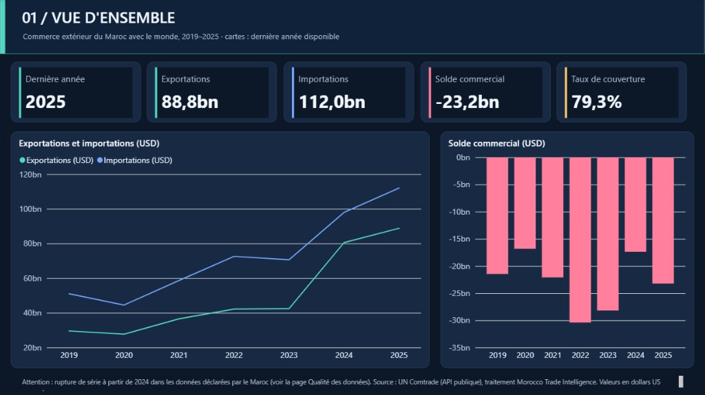
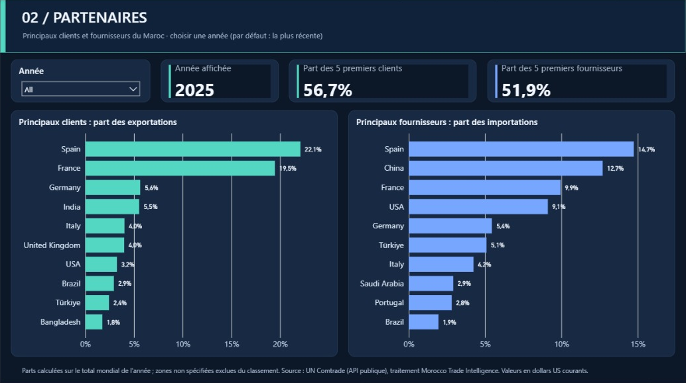
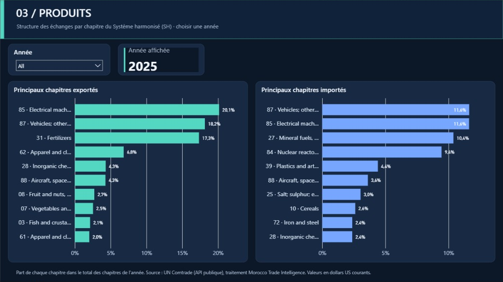
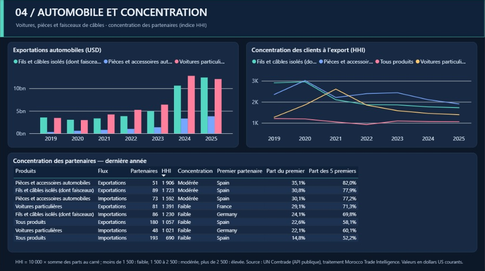
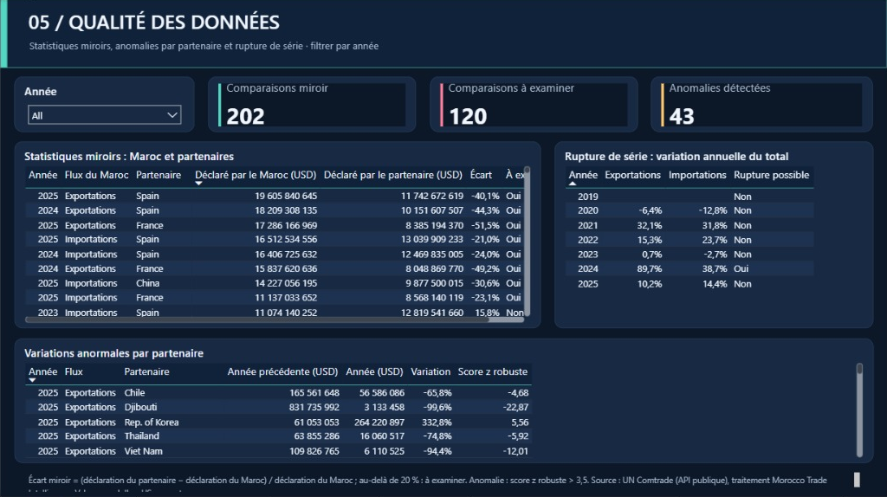
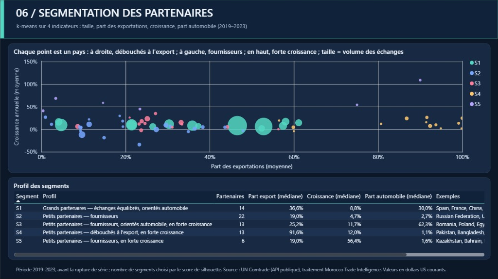

# Rapport Power BI — Morocco Trade Intelligence

Le rapport est fourni au format **Projet Power BI (.pbip)** : des fichiers texte lisibles et versionnés dans Git. Power BI Desktop l'ouvre comme un fichier .pbix.

Il charge directement les tables publiées dans [`data/marts`](../data/marts) sur GitHub. Une **actualisation** dans Power BI Desktop récupère donc toujours les données du dernier rafraîchissement mensuel.

## Aperçu

| | |
|---|---|
|  |  |
|  |  |
|  |  |

Le fichier [`MoroccoTradeIntelligence.pbix`](MoroccoTradeIntelligence.pbix) est un instantané enregistré en novembre 2026, à ouvrir directement. Pour les données les plus récentes, ouvrez le projet `.pbip` et actualisez.

## Les six pages

| Page | Contenu | Tables utilisées |
|---|---|---|
| 01 Vue d'ensemble | Exportations, importations, solde et taux de couverture ; évolution 2019–2025 | `mart_trade_overview` |
| 02 Partenaires | Top 10 des clients et des fournisseurs ; part des 5 premiers | `mart_partner_shares`, `dim_year` |
| 03 Produits | Top 10 des chapitres SH exportés et importés | `mart_chapter_structure`, `dim_year` |
| 04 Automobile et concentration | Exportations automobiles par produit ; indice HHI ; tableau de la dernière année | modèle en étoile (`fct_trade` + dimensions), `mart_concentration` |
| 05 Qualité des données | Statistiques miroirs, rupture de série possible en 2024, anomalies par partenaire | `mart_mirror_gaps`, `mart_trade_overview`, `mart_flow_anomalies` |
| 06 Segmentation | Nuage de points des partenaires par segment k-means ; profil des segments | `mart_partner_segments`, `mart_segment_profiles` |

## Ouvrir le rapport (Power BI Desktop, Windows)

1. Téléchargez le dépôt : sur GitHub, **Code → Download ZIP**, puis décompressez-le.
2. Double-cliquez sur `powerbi/MoroccoTradeIntelligence.pbip`.
3. Si Power BI Desktop refuse d'ouvrir le fichier, activez les fonctionnalités du format projet, puis redémarrez Power BI Desktop :
   - ouvrez **Fichier → Options et paramètres → Options → Fonctionnalités en préversion** ;
   - cochez **Option d'enregistrement de projet Power BI (.pbip)**, **Stocker le modèle sémantique au format TMDL** et **Stocker les rapports au format PBIR**.
4. Cliquez sur **Accueil → Actualiser**.
5. À la première connexion, Power BI demande comment accéder à `raw.githubusercontent.com` : choisissez **Anonyme**, puis **Se connecter**. Si un message sur les niveaux de confidentialité apparaît, choisissez **Public**.

## Enregistrer et partager

- **Fichier .pbix :** Fichier → Enregistrer sous → type « Fichiers Power BI (*.pbix) ».
- **PDF de toutes les pages :** Fichier → Exporter → Exporter au format PDF.
- **Captures pour le README :** une capture par page, dans `powerbi/screenshots/`.

## Mesures DAX

Toutes les mesures sont listées dans [`mesures.dax`](mesures.dax). Deux principes :

- Les pages Partenaires et Produits affichent l'année choisie dans le segment, ou la dernière année si rien n'est choisi (`Année affichée`). Les mesures du top 10 renvoient une valeur vide hors du top 10 : seuls dix partenaires s'affichent.
- La table de faits mélange plusieurs niveaux de produits (TOTAL, chapitres, positions). Les mesures filtrent donc toujours le niveau voulu avant d'additionner.

## Régénérer le projet

Le projet est produit par [`tools/build_powerbi.py`](../tools/build_powerbi.py) :

```bash
python tools/build_powerbi.py
```

Après une modification faite dans Power BI Desktop, enregistrez le projet (Ctrl+S) : les fichiers texte sont mis à jour et peuvent être publiés sur GitHub.

## En cas de problème : construire le rapport à la main

1. **Obtenir les données → Web.** Pour chaque table, collez l'adresse `https://raw.githubusercontent.com/nkhawla000-cmyk/morocco-trade-intelligence/main/data/marts/<nom du fichier>`. Les fichiers .parquet s'ouvrent avec le connecteur Parquet.
2. **Types :** dans Power Query, changez les types avec les paramètres régionaux **Anglais (États-Unis)**, sinon les décimales seront mal lues.
3. **Relations** (vue Modèle, plusieurs-à-un) :
   - `fct_trade[year]` → `dim_year[year]` ;
   - `fct_trade[flow_code]` → `dim_flow[flow_code]` ;
   - `fct_trade[partner_code]` → `dim_country[country_code]` ;
   - `fct_trade[cmd_code]` → `dim_product[cmd_code]` ;
   - `mart_concentration[year]`, `mart_mirror_gaps[year]` et `mart_flow_anomalies[year]` → `dim_year[year]`.
4. **Mesures :** copiez celles de `mesures.dax`.
5. **Pages :** reproduisez les six pages du tableau ci-dessus.
